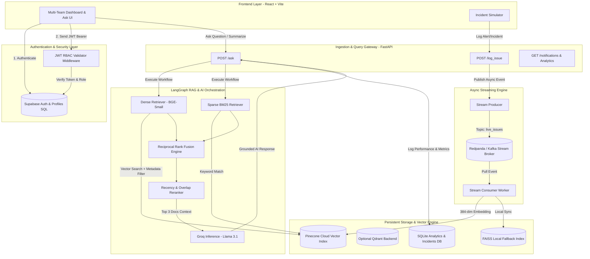
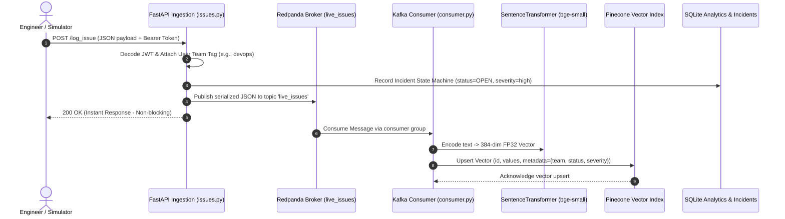
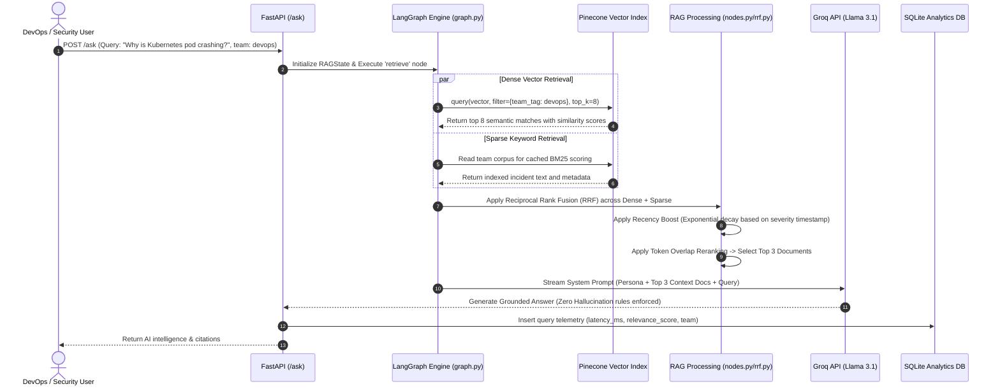
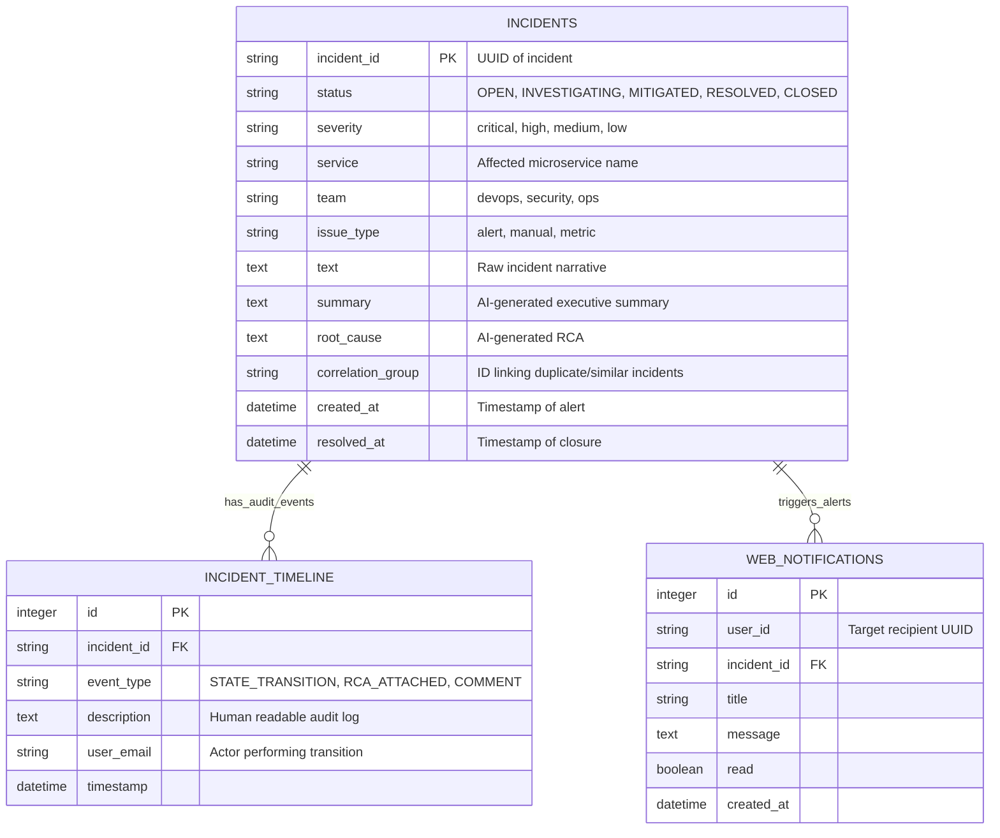

# Real-Time RAG: System Architecture & Data Flows

This document provides a deep, production-level architectural overview of the **Real-Time RAG Incident Intelligence Platform**. It is designed for System Design rounds and architectural presentations during engineering interviews.

---

## 1. High-Level Architecture Overview

The Real-Time RAG platform bridges the gap between **asynchronous operational data streams** and **synchronous AI decision support**. Traditional RAG pipelines rely on static, scheduled indexing runs (e.g., nightly batch vectorization). In cloud operations and cybersecurity, an incident occurs and resolves within minutes; delayed vectorization results in LLM hallucination or stale operational intelligence. 

This platform decouples **ingestion/indexing** from **retrieval/inference** using a scalable, micro-service style streaming pattern built around **Kafka/Redpanda**, **Pinecone**, **LangGraph Orchestration**, and **FastAPI**.



---

## 2. Component Design & Decoupled Architecture

### Runtime deployment mapping

For the hosted setup, the React frontend can be served by Vercel, the FastAPI API
by Render, Kafka-compatible Redpanda and Pinecone remain managed cloud services,
and `stream.consumer` runs as a separate process. The incident path is:

```text
User browser -> Vercel frontend -> Render FastAPI -> Redpanda Cloud
                                                   -> consumer process -> Pinecone
```

The API publishes to Redpanda; it does not write the vector directly. The consumer
initiates an outbound Kafka connection and polls the `live_issues` topic. Redpanda
does not invoke the consumer through a webhook, and the consumer does not require
an inbound public port.

There are two ways to host that consumer:

* **Always-on cloud worker:** deploy `python -m stream.consumer` as a background
  worker on a host that supports continuously running processes. This keeps the
  entire ingestion pipeline cloud-hosted; worker availability and cost depend on
  the provider plan.
* **Free/demo local worker:** run `python -m stream.consumer` on a developer
  computer. It still consumes from cloud Redpanda and writes to cloud Pinecone, but
  indexing pauses while that computer or process is offline. This is not a fully
  cloud-hosted or always-on deployment. The current consumer uses the stable
  `incident-vector-indexer` group, starts at the earliest retained message on its
  first run, and commits offsets only after successful vector writes.

Render Free web services may sleep when idle, and model inference can require
substantially more memory than API startup. Validate the chosen host's memory,
uptime, and persistence limits before treating a demo setup as production-ready.

### Why Decouple Ingestion from Querying?
In high-throughput operational environments (e.g., thousands of microservices emitting alerts and APM metrics), locking a vector database during synchronous REST calls would cause massive API degradation and timeout cascades.

1. **Ingestion Gateway (`POST /log_issue`)**: Acts solely as an **event publisher**. It performs schema validation and RBAC validation, appends user team tags, and publishes a JSON payload to the Redpanda Kafka topic (`live_issues`). Sub-millisecond latency is preserved because no ML embedding generation or indexing happens on the HTTP request thread.
2. **Streaming Consumer (`stream/consumer.py`)**: A persistent background worker that subscribes to `live_issues`. It pulls messages, computes 384-dimensional dense vectors using **Hugging Face BAAI/bge-small-en-v1.5**, and upserts vectors with filterable metadata into the configured shared vector backend (Pinecone by default).
3. **Query Engine (`POST /ask`)**: When an analyst requests situation awareness, the request skips stream brokers and hits the **LangGraph** RAG engine directly, executing dense searches against Pinecone's indexed vectors and metadata filters by default.

---

## 3. End-to-End Data Flows

### A. Ingestion & Vector Indexing Flow



### B. Hybrid RAG Retrieval & AI Generation Flow



---

## 4. Database & Vector Storage Schemas

The platform maintains strict architectural boundaries by using specialized data engines for distinct access patterns:
* **Supabase (PostgreSQL)**: Identity and Access Management (IAM), User Profiles, and RBAC constraints.
* **Pinecone**: Managed high-dimensional vector similarity indexing with metadata filtering (default). Qdrant and FAISS remain optional backends.
* **SQLite (`rag_analytics.db`)**: High-speed local relational tracking of incident state transitions, analytics telemetry, and notifications.

### A. Supabase Profiles Schema (`public.profiles`)
Enforces team scoping and strict architectural role hierarchies in PostgreSQL via triggers and Check Constraints.
```sql
CREATE TABLE public.profiles (
    id UUID PRIMARY KEY REFERENCES auth.users(id) ON DELETE CASCADE,
    email TEXT UNIQUE NOT NULL,
    role TEXT DEFAULT 'analyst' NOT NULL,
    team_name TEXT DEFAULT 'devops' NOT NULL,
    created_at TIMESTAMP WITH TIME ZONE DEFAULT timezone('utc'::text, now()) NOT NULL,
    
    -- Strictly enforced RBAC Roles Check Constraint
    CONSTRAINT profiles_role_check CHECK (
        role IN ('analyst', 'engineer', 'sre', 'team_lead', 'admin')
    ),
    
    -- Team Domain Isolation Constraint
    CONSTRAINT profiles_team_check CHECK (
        team_name IN ('devops', 'security', 'ops')
    )
);
```

### B. Pinecone Vector Record Schema (Index namespace: `incidents`)
Pinecone stores the embedding values with a string record ID and flat, filterable metadata. The index is configured for the embedding dimension and cosine similarity.

```json
{
  "id": "8e3b2f91-da1a",
  "values": [0.034, -0.128, 0.542, "...", "-0.012"],
  "metadata": {
    "text": "Kubernetes pod for search-index in CrashLoopBackOff state after 10:00 AM rollout.",
    "team_tag": "devops",
    "issue_id": "8e3b2f91-da1a",
    "status": "OPEN",
    "severity": "high",
    "service": "search-index-service",
    "timestamp": "2026-08-01T11:20:15.123456"
  }
}
```

### C. Relational Lifecycle & Analytics Schema (`rag/core/incidents.py` & `analytics.py`)



---

## 5. Security & Team Data Isolation (RBAC & Multi-Tenancy)

A paramount concern in operational platforms is data confidentiality: **A DevOps SRE must never have unfettered access to active Security breach investigations or employee data exfiltration alerts** unless explicitly authorized.

1. **Cryptographic Identity via Supabase JWT**: Every request to FastAPI must supply a signed Supabase JSON Web Token (`Bearer eyJhbGciOi...`).
2. **Middleware Verification (`app/auth.py`)**: FastAPI middleware interceptors authenticate the JWT against Supabase's JWKS endpoints and extract user profile claims (`email`, `role`, `team_name`).
3. **Vector Metadata Filtering**: When the user initiates a search or AI query, their `team_name` (e.g., `security`) is applied as a Pinecone metadata filter:
   ```python
   query_filter = {"team_tag": {"$eq": user.team_name}}
   ```
   *The backend applies the team filter before returning vector matches; route-level team authorization remains the primary access-control boundary.*
4. **Endpoint Role Authorization (`app/rbac.py`)**: Critical operational endpoints employ FastAPI dependencies to reject unprivileged roles:
   * `POST /admin/reset_db` -> Restricted to `['admin']`
   * `POST /incidents/{id}/transition` -> Restricted to `['engineer', 'sre', 'team_lead', 'admin']` (Basic analysts can view/query, but cannot alter state machines).
