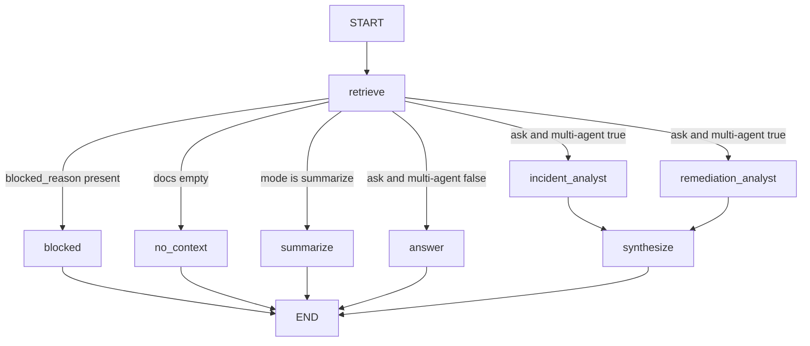
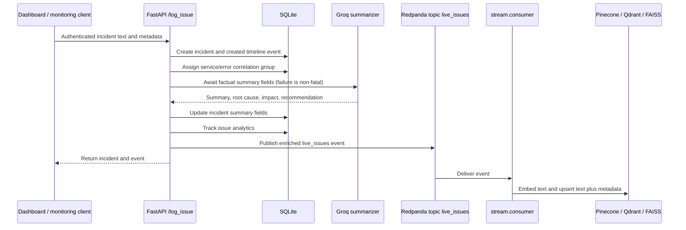

# Retrieval, LangGraph, and Request Flow

This document describes the implemented question-answering and summarization paths
in `agents/`, `retrieval/`, and the corresponding FastAPI routes. It is intended to
complement the repository overview in [README.md](../README.md).

## At a glance

The platform has two separate pipelines:

1. **Incident ingestion and indexing:** persist an incident and its lifecycle
   information, then publish an event for asynchronous vector indexing.
2. **Question answering:** authenticate and authorize a user, retrieve a small set
   of team-scoped incident texts, route through LangGraph, and return an answer.

LangGraph handles the second pipeline only. Incident ingestion, resolution
recommendations, correlation, notifications, and scheduled cleanup use ordinary
FastAPI/service calls rather than graph nodes.

## End-to-end system diagram

```mermaid
flowchart LR
    subgraph Write["Write path: incident ingestion"]
        MON[Monitoring client or simulator] -->|POST /log_issue| API[FastAPI]
        API --> AUTH[JWT verification and team context]
        AUTH --> INC[IncidentManager]
        INC --> SQLITE[(SQLite incidents and timeline)]
        AUTH --> CORR[Correlation group]
        AUTH -->|await| TRIAGE[Groq incident summarization]
        TRIAGE -->|update summary fields| SQLITE
        AUTH --> METRICS[SQLite issue analytics]
        AUTH --> WEB[Web notification]
        AUTH -->|publish live_issues| BUS[Redpanda / Kafka]
        BUS --> CONSUMER[stream.consumer]
        CONSUMER --> EMBED[SentenceTransformer]
        EMBED --> INDEX[(Pinecone, Qdrant, or FAISS)]
    end

    subgraph Read["Read path: user question"]
        USER[Signed-in dashboard user] -->|POST /ask| API2[FastAPI]
        API2 --> AUTH2[JWT, role, and team access]
        AUTH2 --> INPUT[Initial RAGState]
        INPUT --> RETRIEVE[retrieve node]
        RETRIEVE --> DENSE[Dense top 8]
        DENSE <--> INDEX
        RETRIEVE --> SPARSE[Team BM25 top 8]
        INDEX -->|corpus scan or cache refresh| SPARSE
        SPARSE --> FUSE[RRF + recency + lexical rerank]
        DENSE --> FUSE
        FUSE --> BRANCH{Route}
        BRANCH -->|blocked_reason| BLOCKED[blocked node]
        BRANCH -->|no documents| EMPTY[no_context node]
        BRANCH -->|ask and multi-agent enabled| IA[incident_analyst]
        BRANCH -->|ask and multi-agent enabled| RA[remediation_analyst]
        IA --> SYNTH[synthesize]
        RA --> SYNTH
        BRANCH -->|ask and multi-agent disabled| ANSWER[answer]
        BRANCH -->|summarize request| SUMMARY[summarize]
        BLOCKED --> RESPONSE[Graph result: answer]
        EMPTY --> RESPONSE
        SYNTH --> RESPONSE
        ANSWER --> RESPONSE
        SUMMARY --> RESPONSE
        RESPONSE -->|JSON| USER
    end
```



## LangGraph node and edge reference

`agents.graph.build_graph()` compiles the graph once for each mode when the API
module initializes. The graph is then reused; its state is not.

| Node | Purpose | State returned |
|---|---|---|
| `retrieve` | Validate and sanitize the query, search dense and sparse indexes, apply filters and ranking, then keep at most three texts. | `docs`; on rejected input, also `blocked_reason`. |
| `blocked` | Return the guardrail rejection reason without calling the generation model. This branch is selected before the empty-documents branch. | `answer` |
| `no_context` | Return a groundedness response when retrieval returned no documents. No LLM call is made. | `answer` |
| `incident_analyst` | In multi-agent `/ask`, identify evidence about matching incidents, status, severity, recency, root cause, and impact. | `incident_analysis` |
| `remediation_analyst` | In multi-agent `/ask`, identify historical remediation evidence and distinguish it from cautious recommendations. | `remediation_analysis` |
| `synthesize` | Combine the two specialist notes into one response, using only those notes. | `answer` |
| `answer` | In single-agent `/ask`, write the direct response grounded in retrieved incident text. | `answer` |
| `summarize` | Produce an executive summary, root-cause patterns, impact assessment, and recommended remediation from retrieved text. | `answer` |

The graph structure and routing are:



The two specialist nodes are parallel graph branches. Each receives the same
retrieved `docs` and `query`; neither has a direct channel to the other. LangGraph
merges each node's returned fields into the shared run state. `synthesize` reads
`incident_analysis` and `remediation_analysis` from that state. The specialists
therefore coordinate through structured state updates, not messages, a shared
external database, or another agent framework.

For a successful multi-agent `/ask`, the graph normally makes three Groq calls:
one per specialist and one synthesis call. Single-agent `/ask` and `/summarize`
make one generation call each. Blocked and empty-result paths make none.

## Request state and memory boundaries

`agents.state.RAGState` is a `TypedDict` with optional fields. The API constructs a
new initial state for each request and invokes the compiled graph with
`ainvoke()`.

| Field | Set by | Used for |
|---|---|---|
| `query` | API request | Retrieval and answer prompts. |
| `team` | Authenticated profile or authorized `team_id` | Team-scoped dense and sparse retrieval and team-specific prompt context. |
| `user_context` | API (`email`, `role`) | Context in the single-answer system prompt. Specialist prompts use the team but do not receive this field. |
| `status_filter` | Optional `/ask?status=...` | Dense and sparse incident filtering. |
| `severity_filter` | Optional `/ask?severity=...` | Dense and sparse incident filtering. |
| `docs` | `retrieve` | Up to three retrieved incident text strings shared with later nodes. |
| `blocked_reason` | `retrieve` | Guardrail failure; routes to `blocked`. |
| `incident_analysis` | `incident_analyst` | Specialist result consumed by `synthesize`. |
| `remediation_analysis` | `remediation_analyst` | Specialist result consumed by `synthesize`. |
| `answer` | Terminal response node | Text returned by the API. |

The state exists for one graph execution. The compiled graph object is reused, but
the question, documents, and analysis fields are initialized/merged per request.
There is no LangGraph checkpoint store, conversation/thread memory, or retained
chat history in this flow. The request ID is used for analytics and optional
LangSmith trace metadata; it is not a graph conversation key.

`ainvoke()` returns the final merged state mapping. The current `/ask` and
`/summarize` routes return that mapping as JSON, so the response includes `answer`
and can also include `query`, retrieved `docs`, supplied context/filter fields, and
(for multi-agent `/ask`) the two specialist analysis fields. It is not reduced to
the answer string at the API boundary.

## Retrieval pipeline

`agents.nodes.retrieve_node()` implements the retrieval sequence:

1. **Input gate:** reject empty input and queries containing configured prompt
   injection signatures; truncate input longer than 2,500 characters.
2. **Secret sanitization:** redact configured credentials from the accepted query
   before searching and from incident context before LLM calls.
3. **Dense search:** `DenseRetriever` delegates to `VectorStore.search()` for up to
   eight candidates. Pinecone can apply team, status, and severity metadata filters
   during vector search; the retrieval node also applies team/status/severity and
   recency checks to dense results.
4. **Sparse search:** get a cached `rank-bm25` index from
   `get_cached_sparse_retriever()`, scoped to the selected team, and request its
   top eight results. Apply status, severity, and recency checks to those results.
5. **Rank fusion:** merge dense and BM25 candidate order with reciprocal-rank
   fusion. With the default `k=60`, each list contributes `1 / (60 + rank)` for a
   document's rank; the BM25 score itself is used to order the sparse result list.
6. **Recency adjustment:** normalize the RRF score to the best fused candidate and
   combine it with the configured exponential recency score.
7. **Lexical overlap rerank:** blend 70% of the pre-rerank relevance score with
   30% query-term overlap, then select the first three.
8. **Context reduction:** return only the selected texts. Metadata is used for
   filtering/scoring but is not passed as a separate structured object to the
   generation nodes.

The scoring performed by the current implementation is:

```text
rrf_score(document) = sum(1 / (60 + rank)) over dense and sparse result lists
recency_score = exp(-0.693 * age_days / max(window_days / 3, 1))
pre_rerank = 0.8 * normalized_rrf_score + 0.2 * recency_score
overlap_ratio = matched unique query terms / unique query terms
rerank_score = 0.7 * pre_rerank + 0.3 * overlap_ratio
```

The recency window defaults are 90 days for critical, 60 for high, and 30 for
medium, normal, and low severity. They can be changed with the
`RECENCY_*_DAYS` environment settings. A document outside its severity window is
filtered out. A missing or unparsable timestamp is retained by the window filter
and receives the recency helper's default score.

### BM25 cache behavior

`retrieval.bm` maintains a process-local cache guarded by a lock. The index is
rebuilt after writes observed through `VectorStore.corpus_revision`, or when the
30-second refresh interval expires. Local writes can invalidate the cache
immediately; writes from another process are noticed on refresh. Rebuilding scans
the vector corpus. This cache is not a distributed sparse index and should be
benchmarked if the corpus or update rate grows substantially.

## User request paths

### `/ask`

1. A user signs in through Supabase Auth in the React app. Protected dashboard
   routes wait for an active Supabase session and redirect signed-out users to
   `/login`.
2. The dashboard API client reads the session access token and sends it as a
   bearer token with the plain-text question to `POST /ask`; optional `team_id`,
   `status`, and `severity` are query parameters.
3. FastAPI resolves the Supabase JWT/profile and checks that the user can access
   the requested team. Non-team-lead users are restricted to their own team;
   admins and team leads can access other teams.
4. The route creates a request ID and passes the question, team, profile context,
   and optional filters into the per-request graph state.
5. LangGraph runs `retrieve`, selects the blocked/no-context/single-agent/
   multi-agent branch, and returns an `answer`.
6. The API records query timing/analytics and returns the final graph state as JSON.

### `/summarize`

This endpoint uses the same auth/team check and retrieval path, but builds the
summarize-mode graph. When documents exist, `summarize` produces the structured
incident summary; no specialist fan-out occurs.

### `/recommend`

This endpoint is separate from LangGraph. It searches for up to five similar
incidents and passes the matches to `recommend_resolution()`. If no similar
incidents are found, it returns an escalation-oriented no-match message rather
than invoking the recommendation model.

## Incident ingestion and index lifecycle



The issue route writes the SQLite lifecycle record before publishing the event.
The vector index is populated by the separately run consumer, so a newly created
incident may not be searchable immediately. The producer logs and skips the event
when Kafka is unavailable; successful SQLite persistence does not itself guarantee
that a vector point was indexed.

The status update route transitions the incident in SQLite and replaces its vector
point with updated status metadata. The cleanup scheduler archives old resolved
records and removes expired closed incidents and their vector/analytics records.
See `core/incidents.py`, `app/issues.py`, `stream/`, and `jobs/` for the
implementation.

The grounded-context helper uses a 20-character minimum in the `answer` and
`summarize` nodes. The graph-level `no_context` branch handles an empty document
list; it is not the same check as the 20-character threshold. The two specialist
nodes currently rely on the graph's non-empty-document routing and do not call that
helper themselves, so non-empty but very short retrieved text can still reach the
multi-agent LLM branches.

## Source map

| File | Responsibility |
|---|---|
| `agents/state.py` | Typed per-run graph state. |
| `agents/graph.py` | Graph construction, mode wiring, routing conditions, and conditional branches. |
| `agents/nodes.py` | Guarded retrieval and LLM answer, specialist, synthesis, and summary nodes. |
| `app/main.py` | FastAPI app, graph construction, auth/team checks, `/ask`, `/summarize`, `/recommend`. |
| `app/issues.py` | Incident creation, lifecycle updates, similar incident and RCA endpoints. |
| `app/auth.py`, `app/rbac.py` | Supabase JWT/profile resolution and role/team access helpers. |
| `retrieval/dense.py` | Dense retriever adapter to `VectorStore`. |
| `retrieval/bm.py` | Team-scoped BM25 search and process-local index cache. |
| `retrieval/rrf.py` | Reciprocal-rank fusion of dense and sparse lists. |
| `retrieval/recency.py` | Severity-specific recency window and ranking adjustment. |
| `retrieval/rerank.py` | Query/document token-overlap reranking. |
| `core/vector_store.py` | Backend facade, write revision tracking, and search delegation. |
| `core/vector_backends/pinecone_backend.py` | Pinecone index, embedding, metadata filters, and vector operations (default). |
| `core/vector_backends/qdrant_backend.py` | Optional Qdrant collection, embedding, metadata filters, and vector operations. |
| `core/embeddings.py` | SentenceTransformer model loading and encoding. |
| `core/guardrails.py` | Query gate, secret redaction, and grounded-context check. |
| `core/summarizer.py` | Ingestion summaries, RCA generation, and recommendation generation. |
| `stream/producer.py`, `stream/consumer.py` | Kafka publication and asynchronous vector indexing. |

## Operational settings

| Setting | Default | Effect |
|---|---|---|
| `RAG_MULTI_AGENT_ENABLED` | `true` | Select multi-agent specialist/synthesis or single `answer` for `/ask`. |
| `VECTOR_BACKEND` | `pinecone` | Select Pinecone, optional Qdrant, or local FAISS backend. |
| `PINECONE_API_KEY`, `PINECONE_INDEX_NAME`, `PINECONE_NAMESPACE` | —, —, `incidents` | Configure the Pinecone connection and namespace. |
| `QDRANT_HOST`, `QDRANT_PORT`, `QDRANT_COLLECTION` | `localhost`, `6333`, `incidents` | Configure Qdrant when `VECTOR_BACKEND=qdrant`. |
| `EMBEDDING_MODEL`, `EMBEDDING_DIM` | `BAAI/bge-small-en-v1.5`, `384` | Embedding model and expected vector size. |
| `LLM_MODEL` | `llama-3.1-8b-instant` | Groq model used by graph and incident-generation helpers. |
| `RECENCY_CRITICAL_DAYS`, `RECENCY_HIGH_DAYS`, `RECENCY_MEDIUM_DAYS`, `RECENCY_NORMAL_DAYS`, `RECENCY_LOW_DAYS` | `90`, `60`, `30`, `30`, `30` | Candidate recency windows. |

The relevant secrets and service credentials are read from environment variables;
never put real credentials in documentation or source control. For the broader
setup and endpoint list, see [README.md](../README.md).
